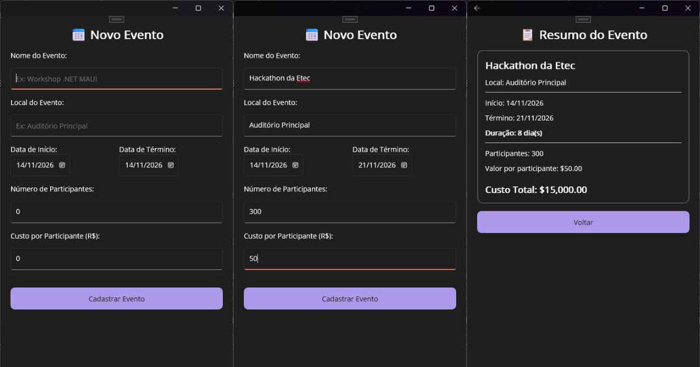

# 📅 App Eventos em .NET MAUI

Aplicativo de **Cadastro e Gestão de Eventos** desenvolvido para a disciplina do curso técnico em Desenvolvimento de Sistemas da **Etec**. O projeto utiliza **C#** e **XAML** com a plataforma **.NET MAUI**, explorando conceitos avançados de *Data Binding*, manipulação de datas com `DateTime` e `TimeSpan`, e customização de janelas no formato mobile.

---

## 📸 Demonstração da Aplicação

---

## 🚀 Funcionalidades

- **Cadastro de Eventos**: Entrada interativa de dados básicos como nome, local, quantidade de participantes e custo unitário.
- **Controle de Período**: Seleção de datas de início e término via `DatePicker`, com validação automática para impedir datas retroativas ou de término anteriores ao início.
- **Cálculo Automático**: Uso nativo de `DateTime` e `TimeSpan` para calcular a duração exata do evento em dias, além da multiplicação automática do custo total por participante.
- **Tela de Resumo**: Navegação por pilha (`Navigation.PushAsync`) exibindo um painel detalhado com todas as informações formatadas (`StringFormat` para moeda e datas).
- **Layout Personalizado**: Design estilizado em proporção vertical simulando um smartphone, sem barra de navegação padrão e com suporte a *Dark Mode*.

---

## 🛠️ Tecnologias Utilizadas

- **.NET MAUI** (Multi-platform App UI)
- **C#** (Lógica de negócios, manipulação de datas e navegação)
- **XAML** (Interface gráfica, *Data Binding* e estilização visual)
- **Visual Studio** (Ambiente de desenvolvimento)

---

## 📁 Estrutura do Código

- `App.xaml.cs`: Configuração da inicialização da aplicação e definição do tamanho e proporção inicial da janela no formato mobile.
- `Models/Evento.cs`: Classe modelo contendo as propriedades principais e as regras de negócio para cálculo dinâmico da duração e do custo total.
- `Views/CadastroEventoPage.xaml`: Formulário de cadastro com campos de entrada, seletores de data e tratamento de validações.
- `Views/ResumoEventoPage.xaml`: Página de exibição do resumo estruturada em um card moderno com bordas arredondadas e botão de retorno.

---

## 👨‍💻 Autor

**Hugo Arcanjo**

---

## 📄 Licença

Este projeto é um trabalho acadêmico desenvolvido para estudo no curso técnico da Etec.